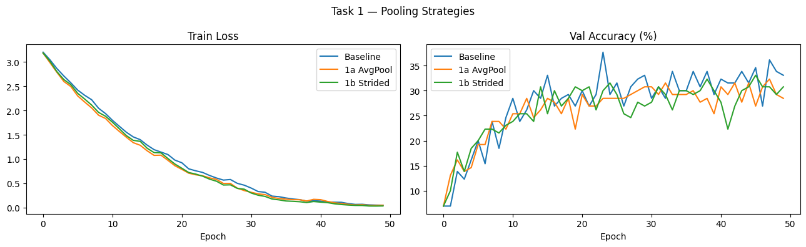
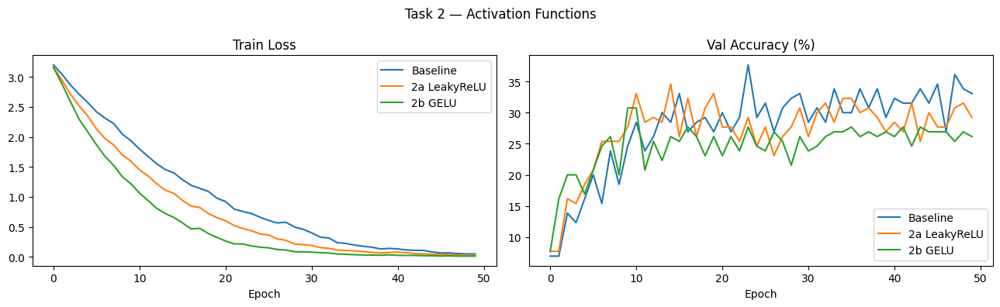
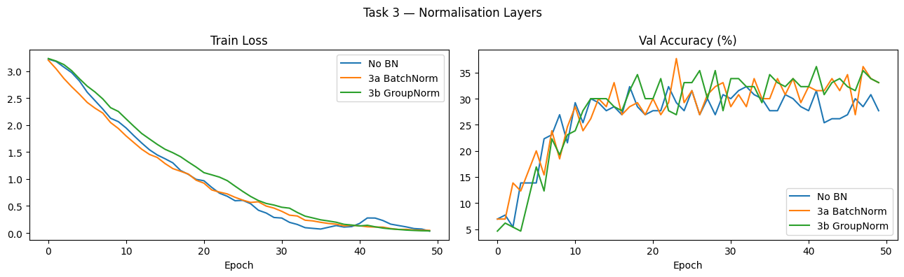
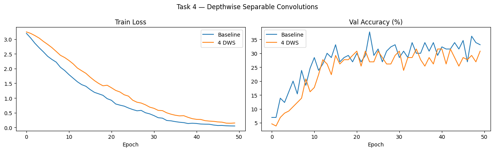
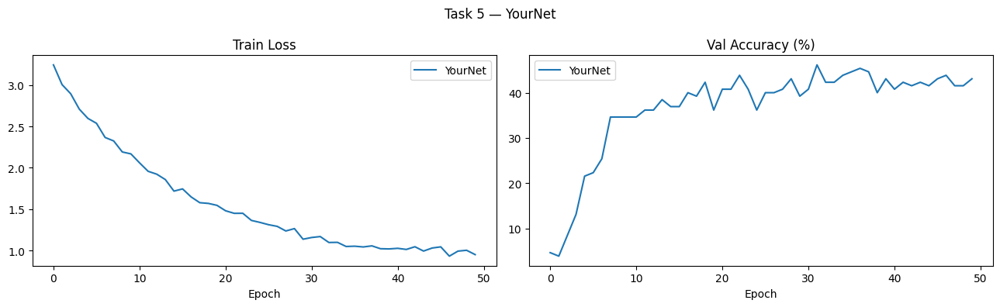

# 🐦 Fine-Grained Bird Classification: CNN Architecture Ablations

This project studies **how individual architectural choices affect a small CNN on a small, fine-grained dataset**, and then designs a custom, parameter-efficient network under a strict budget.

Starting from a LeNet-style baseline, each experiment changes **exactly one component** (pooling, activation, normalisation, convolution type) and compares the result against the baseline. The lessons are then combined in **YourNet**, a hybrid CNN with **437,593 parameters** that reaches **46.15% validation accuracy**, a gain of **+8.46 points** over the baseline.

---

## 🚀 Objectives

- Compare **pooling strategies**: MaxPool vs. AvgPool vs. strided convolutions
- Compare **activations**: ReLU vs. Leaky ReLU vs. GELU
- Compare **normalisation**: none vs. BatchNorm vs. GroupNorm
- Measure the **parameter / accuracy trade-off** of depthwise separable convolutions
- Design a network under hard limits: **≤ 500k parameters, ≤ 50 epochs, no pre-trained weights**
- Explain *why* each change helps or hurts, not only report numbers

---

## 📂 Project Structure

```
.
├── CNN_Ablations.ipynb         # all experiments, curves and YourNet training
├── task5/
│   ├── model.py                # self-contained YourNet definition
│   └── best_model.pth          # trained weights (state_dict)
├── assets/                     # result figures used in this README
└── README.md
```

---

## 📊 Dataset & Setup

- **Data:** a 25-class subset of [CUB-200-2011](https://www.vision.caltech.edu/datasets/cub_200_2011/), high-resolution bird photos with very small inter-class differences. The images are not included. Set `DATA_ROOT` in the notebook to a folder containing `train_imgs/<class_folder>/...`.
- **Split:** fixed-seed stratified **80/20 train/validation** split carved out of `train_imgs/`
- **Preprocessing:** resize to **128×128**, ImageNet mean/std normalisation
- **Training:** Adam (lr 1e-3), cross-entropy, 50 epochs, seed 66 for full reproducibility
- **Baseline `LeNetBase`:** 3 × (Conv3×3 + BN + ReLU + MaxPool) with channels 3→32→64→128, adaptive average pooling to 4×4 and three FC layers (128·16 → 128 → 64 → 25); **365,849 parameters**

---

## 🧠 Experiments

### 1. Pooling strategies

| Variant | Best val. acc. |
|---|---|
| **MaxPool (baseline)** | **37.69%** |
| AvgPool | 32.31% |
| Strided convolutions | 33.08% |



- **Max-pooling wins.** Fine-grained cues such as beak shape or eye-ring texture appear as *strong local activations*; averaging smooths them away.
- AvgPool also shows severe overfitting: training loss goes to near zero while validation accuracy plateaus.
- **Strided convs** are the fastest variant (about 95 s) and slightly better than AvgPool because the downsampling kernel is learned, but one kernel must both extract features and downsample.

### 2. Activation functions

| Variant | Best val. acc. | Best epoch |
|---|---|---|
| **ReLU (baseline)** | **37.69%** | 24 |
| Leaky ReLU (α = 0.1) | 34.62% | 15 |
| GELU | 30.77% | 10 |



- ReLU's **sparsity acts as a regulariser** on this small dataset
- Leaky ReLU avoids dying units but its denser activations add noise
- GELU, smooth and input-gated (`GELU(x) = x·Φ(x)`), helps big transformers but converged early at a poor optimum in this shallow CNN

### 3. Normalisation

| Variant | Best val. acc. | Best epoch |
|---|---|---|
| No normalisation | 32.31% | 18 |
| **BatchNorm** | **37.69%** | 24 |
| GroupNorm (8 groups) | 36.15% | 42 |



- Without normalisation, **validation loss grows unboundedly** (up to about 8.5 at epoch 50) while training loss falls, which is clear overfitting
- **BatchNorm** stabilises training and restores baseline accuracy
- **GroupNorm** is slightly lower and converges later; with batch size 64 BatchNorm's statistics are already reliable, so GN's batch-size independence gives no advantage here

### 4. Depthwise separable convolutions

| Variant | Best val. acc. | Parameters |
|---|---|---|
| Standard convs (baseline) | 37.69% | 365,849 |
| **Depthwise separable** | 31.54% | **284,026** (−22%) |



A depthwise conv filters each channel independently and defers cross-channel mixing to the 1×1 pointwise conv. That saves 22% of the parameters, but is less expressive for the complex texture correlations that fine-grained classification needs.

---

## 🏆 YourNet: Best Architecture

**437,593 parameters (87.5% of the 500k budget), 46.15% validation accuracy at epoch 32.**

```
Input 3×128×128
 ├─ Block 1  Conv 3→32   + BN + ReLU + MaxPool   → 32×64×64
 ├─ Block 2  Conv 32→64  + BN + ReLU + MaxPool   → 64×32×32
 ├─ Block 3  DWS 64→96   + BN + ReLU + MaxPool   → 96×16×16
 ├─ Block 4  DWS 96→128  + BN + ReLU + MaxPool   → 128×8×8
 ├─ Block 5  DWS 128→160 + BN + ReLU             → 160×8×8   (no pooling: keep spatial detail)
 └─ AdaptiveAvgPool(3×3) → Dropout(0.3) → FC 1440→256 + BN + ReLU → Dropout(0.3) → FC 256→25
```



**Design choices and why**

| Choice | Reason |
|---|---|
| 5 blocks instead of 3 | a deeper hierarchy for subtle visual differences |
| **Hybrid**: standard convs first, DWS later | standard convs capture low-level cross-channel correlations; DWS saves parameters so the network can go deeper within budget |
| Two Dropout(0.3) layers | main regulariser with only ~570 training images |
| Cosine annealing LR | smooth decay lets later epochs make fine weight updates |
| Heavy augmentation | simulates positional and lighting variation in a low-data regime |

**Augmentation pipeline**

```python
transforms.Compose([
    transforms.RandomResizedCrop(128, scale=(0.85, 1.0)),
    transforms.RandomHorizontalFlip(),
    transforms.ColorJitter(brightness=0.3, contrast=0.3, saturation=0.2, hue=0.05),
    transforms.RandomRotation(degrees=10),
    transforms.RandomGrayscale(p=0.1),   # reduces colour bias, favours texture and shape
    transforms.ToTensor(),
    transforms.Normalize(MEAN, STD),
])
```

Validation uses only `Resize` + `Normalize`.

---

## 💻 Usage Examples

**Load the trained model and classify an image**

```python
import torch
from PIL import Image
import torchvision.transforms as T
from task5.model import YourNet

net = YourNet()
net.load_state_dict(torch.load("task5/best_model.pth", map_location="cpu"))
net.eval()

prep = T.Compose([T.Resize((128, 128)), T.ToTensor(),
                  T.Normalize([0.485, 0.456, 0.406], [0.229, 0.224, 0.225])])
x = prep(Image.open("bird.jpg").convert("RGB")).unsqueeze(0)
with torch.no_grad():
    pred = net(x).argmax(1).item()      # index of one of the 25 classes
print(pred, sum(p.numel() for p in net.parameters()))   # 437593
```

**Run an ablation yourself** (inside the notebook)

```python
START_seed()
model_avg = LeNet_AvgPool()
best_acc, losses, accs = run_experiment(model_avg, train_loader, val_loader)
```

---

## 📈 Full Results

| Experiment | Best val. acc. | Epoch | Params |
|---|---|---|---|
| Baseline LeNet | 37.69% | 24 | 365,849 |
| AvgPool | 32.31% | 48 | 365,849 |
| Strided conv | 33.08% | 46 | 365,849 |
| Leaky ReLU | 34.62% | 15 | 365,849 |
| GELU | 30.77% | 10 | 365,849 |
| No normalisation | 32.31% | 18 | 365,401 |
| BatchNorm | 37.69% | 24 | 365,849 |
| GroupNorm | 36.15% | 42 | 365,849 |
| Depthwise separable | 31.54% | 35 | 284,026 |
| **YourNet** | **46.15%** | 32 | 437,593 |

---

## 🔍 Key Insights

- **BatchNorm** was the single most impactful component
- **MaxPool** beats AvgPool and strided convs for fine-grained discrimination
- **ReLU** remained the best activation; its sparsity regularises on small data
- DWS convolutions cut parameters by 22% at an accuracy cost, but **used selectively** (later blocks only) they buy depth within a budget
- The biggest gains in YourNet came from **depth, strong augmentation and dropout**, showing that careful design and regularisation can matter more than raw capacity on small datasets

---

## 📌 Implementation Notes

- The random seed is fixed everywhere, with deterministic cuDNN settings
- One run with Leaky ReLU shows an unusually long wall-clock time because the session was interrupted on CPU; its accuracy is unaffected
- Accuracy is reported as the best validation accuracy over all 50 epochs, together with its epoch
- `task5/model.py` is self-contained: `from model import YourNet` works without any other file

---

## 🧾 Conclusion

Controlled single-change ablations reveal which components genuinely help in a low-data, fine-grained setting. Combining a deeper hybrid architecture with targeted augmentation and dropout lifted accuracy from 37.69% to 46.15% while staying well inside a 500k-parameter budget.
